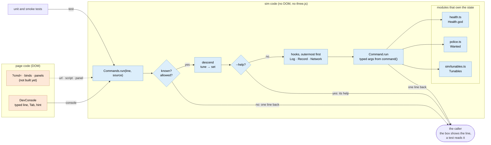

# The console

How in-game commands work, and how the console grows into the base for dev tools: the contract every module
registers against, what is built, and what comes next. The player-facing story is
[#218](https://github.com/OliverRomhagen/vrigstad-joyride/issues/218).

## The shape

```
 sources                     registry (sim code: no DOM)                 modules
 ───────                     ───────────────────────────                 ───────
 DevConsole (typed, Tab) ─┐
 E, touch         (input) │
 ?cmd= at start*    (url) ├─► Commands.run(line, source) ─► hooks ─► Command.run ─► wallet, pets, police, …
 binds, exec*    (script) │     │ access check                 (outermost first)        (their own API)
 panels*          (panel) │     │ alias → name
 tests             (test) ┘     │
                                └─► one line back ─► the console's output (the Log tab, later)
```

`*` not built yet: steps 4 and 7 of [What comes next](#what-comes-next).

- **`Commands`** (`src/game/commands.ts`) is the one registry. It is sim code, so it runs in a unit test, a worker
  or a server, and it knows nothing about the box you type into.
- **`DevConsole`** (`src/game/devconsole.ts`) is page code: the DOM box, its keys, history and focus. It sends lines
  to the registry and prints what comes back. Svelte replaces it after #51; the registry doesn't change.
- **Modules own their commands.** A command is registered in the module that owns the state it changes, next to the
  rule it calls, and `main.ts` calls the module's register function once. It takes `Pick<Commands, 'register'>`:
  - a class registers its own with a `registerCommands` method (`Pets`, `Wanted`);
  - a module of plain data and functions exports `register<Area>Commands` (`registerWalletCommands` in
    `src/game/economy.ts`, `registerHealthCommands` in `src/game/health.ts`).

  The one exception is an adapter that makes commands for every entry of a registry, such as the tunables' `set` and
  `get` (#357): it gets a `*-commands.ts` file of its own beside the registry, since no one entry owns those commands.

## A walkthrough

The console is the "commands in" door of [Commands in, events out](../ARCHITECTURE.md#commands-in-events-out): a
typed line, a panel's slider, a link's `?cmd=`, a replay and, later, another player all reach the game the same way,
as a line through `Commands.run`. So most new systems meet it: they register a few commands, and the tools around
the registry (help, Tab, the Log, Record) work for them without changes. This section follows real lines through it.



Orange is page code, blue is sim code: the line between them is [the layers in
ARCHITECTURE.md](../ARCHITECTURE.md), and Fallow keeps it (`fallow.toml`). The registry, the commands and the state
they change never touch the DOM, so every step below runs in a unit test.

### `tune set driving.grip 8`: a group over a registry

1. **The box** (`src/game/devconsole.ts`) sends the line to `commands.run(line)`, with source `console`.
2. **`Commands.run`** (`src/game/commands.ts`) splits it into words, finds `tune` (an alias would resolve to it
   here), and checks its access. Then `descend` follows the words that name subcommands: `tune` is a `group()`, so
   `set` picks its `set`, and `driving.grip 8` is left as the arguments.
3. **The hooks** each get the call, `{ name: 'tune', args: ['set', 'driving.grip', '8'], source: 'console' }`, and
   call `next()` to go on.
4. **`command()`** (`src/game/command-args.ts`) parses the arguments it was built with:
   `choice('tunable', () => tunables.keys())` accepts `driving.grip`, and `num('value')` reads `8` (`8,5` works too).
   A word that doesn't parse throws a `UsageError`, which comes back as the error and the usage line, so `run` only
   ever sees good values.
5. **The adapter's `run`** (`src/game/sim/tunable-commands.ts`) calls `tunables.set('driving.grip', 8)`. The
   registry (`src/game/sim/tunables.ts`) checks the range and writes the number into the `DRIVING` object in
   `src/game/cars.ts`, which `addFields` connected it to.
6. **The next frame**, `Fleet.drive` reads `DRIVING.GRIP` as always: the car corners differently, and nothing in the
   driving model knows a console exists. The box shows `driving.grip = 8 1/s (was 12)`.

### `god`: one flag, three rules

1. `registerHealthCommands` (`src/game/health.ts`) registered `god` with one optional argument, `toggle('mode')`, so
   `god`, `god on` and `god nej` all parse, and Tab offers `on` and `off`.
2. Its `run` sets `Health.god`, fills the health up when it switches on, and redraws the health bar. That is all
   the command does.
3. Three rules read the flag, each in its own module: `canHurt` in `health.ts` takes no health, `crashCars` spares the
   car you drive (`crashes.ts` passes it in), and `Wanted.update` in `police.ts` never starts a catch. `main.ts` hands
   the flag to the last two as `get god()`, so neither reads the `Health` state itself.

A command stays thin: the rules, and their unit tests, live in the modules. Another source that sets god mode, such
as a cheat code or a lab flag, sets the same field and gets the same three rules.

### A hook: the Log, in a few lines

```ts
const lines: { text: string; source: CallSource }[] = [];
const stop = commands.use((call, next) => {
  const answer = next(); // runs the command, and any hooks inside this one: { ok, text }
  lines.push({ text: `${[call.name, ...call.args].join(' ')} → ${answer.text}`, source: call.source });
  return answer;
});
```

The hook never names a command, yet it sees `tune set`, `god`, `kr` and every command still to be written. The Log
tab (step 4 of [What comes next](#what-comes-next)) and replays (Record, #49) are hooks like this one. A hook sees
`tune` as the name and `set` as the first argument, so this one joins the name and every argument back into the
line.

### Adding a command

1. Put it in the module that owns the state: a `registerCommands` method on a class, or a `register<Area>Commands`
   function beside the rule (see [The shape](#the-shape)).
2. Build it with `command()`: a `help` line of up to 80 characters, `examples` that start with its name, and typed
   `args`, so parsing, the usage line and Tab come for free.
3. Keep `run` to reading its values and calling the module's API, and return one line to show, or
   `refuse(code, reason)` when the module's rule said no.
4. Call the register function in the module's unit test: a missing help line or a bad example fails there, in
   seconds, rather than when the page starts.
5. Call it once from `src/game/main.ts`, next to the others. `help` lists the command; nothing else needs to change.

### `enter`: a player action, picked by E

1. `Actions` (`src/game/actions.ts`) registers `enter` and `exit` with access `player`. Each one's `run` calls the
   rule beside it, `enterCar` or `exitCar`, which checks that it can happen (a car in reach, slow enough to get out)
   and returns the line to show, or a refusal.
2. **E only picks.** `Actions.action` looks at where you stand: inside a house, at a cat, at the kiosk, in a car, beside
   one. For getting in or out it runs `commands.execute('enter', 'input')`, so a key press, a typed `enter` and a test's
   `commands.run('enter', 'test')` reach the same rule through the same hooks.
3. **A refusal carries its reason.** A rule that says no returns `refuse('Slow down before you get out.')`. E shows
   the reason of a refused `input` call as a toast, in one place, so no rule toasts for itself and a hook that refuses
   is heard too. The line of a run that was done, E drops: the player sees that happen. The console shows either.
4. **The hooks see it** as `{ name: 'enter', args: [], source: 'input' }`. That call is all a replay or another player
   needs (#361, #1), and what a tutorial waits for.

Getting in and out of a car came first (#366). The other things E does (the kiosk, the cats, a safehouse, Skroten)
still run straight from `Actions.action`, and move over the same way.

## The contract

### A command

```ts
commands.register('go', command({
  help: 'go to a place, in the car if you are in one',
  aliases: ['tp'],
  access: 'dev',                                        // the default; 'player' runs outside dev mode too
  args: [choice('place', () => [...spots.keys()]), optional(int('speed', { min: 0, max: 200 }))],
  run: ({ place, speed }, call) => goTo(place, speed),  // place: string, speed: number | undefined
}));
```

- `command()` (`src/game/command-args.ts`) builds a `Command` from typed arguments: `int`, `num` (a Swedish comma
  works), `word`, `toggle` (on/off, ja/nej), `choice` and `rest`, each `optional()` at the end. From that one list come
  the parsing, the usage line (`<place> [speed]`), the error lines (`No place called gnosjö. Usage: go <place>
  [speed]`) and Tab completion. `run` gets the values by name, typed: a choice is its own union of words. A choice of
  up to 8 words lists them in its error (`Pick one of: kiosk, skroten, torget.`), since the console on a phone has no
  Tab; a longer one, such as the tunables' keys, keeps the short line.
- A `choice` given a function reads it on every use, so a list that grows while the game runs (car models, unlocked
  places) completes and parses without registering again.
- The plain shape still works: `register(name, { usage, help, run(words) })`, throwing `UsageError` for bad
  arguments. The existing commands (`kr`, `mynt`, `adopt`, `clear`) use it, and move over when someone touches them.
- **A group** holds commands under one name: `group({ help, subcommands: { set, get } })` registers `tune`, and
  `tune set driving.grip 8` runs its `set`. Use one for a family of commands with names that other areas could want
  (`list`, `reset`). The registry follows the subcommands for help, `--help`, Tab and the usage line, so
  `tune set --help` and `help tune set` both work; hooks see the group's name, with the subcommand as the first
  argument. A subcommand's examples start with the whole path (`tune set …`).
- **Every command explains itself.** `help` is required: one line of up to 80 characters (`HELP_MAX`) saying what it
  does, and `register` refuses a command without it. Commands register at start-up, so a refused one stops the whole
  page: a module that registers commands calls its register function in a unit test (`registerWalletCommands` in
  `tests/unit/game/economy.test.ts`), which catches it in seconds. `details` (a few lines), `examples` (whole lines, each starting
  with the command's name or an alias) and a line per argument (`described(int('speed'), 'km/h')`) are optional.
  `help <command>` shows all of it, and so does `<command> --help` or `-h`, which the registry answers for every
  command before it runs: no command handles `--help` itself. Only `--help` or `-h` on its own after the name counts
  (`kr 3 --help` runs `kr`), so no command can take `-h` as its only value. Like an unknown command, the answer doesn't
  pass through the hooks: it changes nothing.
- **A command is thin.** It reads its arguments and calls the module's own API, and the rule lives in the module,
  where a unit test reaches it without the console. `run` returns one line to show (English: it is UI text), or ''.
- **A run is done or refused.** A string from `run` means the command was done. When it understood the line but the
  game's rules said no, it returns `refuse('no-car-in-reach', 'No car in reach.')` (`src/game/commands.ts`): the
  refusal's name, kebab-case, and the reason as the line to show. Code that reacts to a refusal (a tutorial, a sound,
  a test) matches on the name in `outcome.code`, never on the sentence, which stays free to be reworded. The registry's
  own refusals are named in `REFUSAL`: `unknown-command`, `not-allowed`, `usage` and `hook`. A refusal is a returned value, not an exception: the rule that says no is a plain function that other code
  calls too. Bad arguments still throw a `UsageError`. `commands.execute(line, source)` gives the caller the whole
  `Outcome`, `{ ok, text, code }`, and `commands.run(line, source)` only its `text`, for a caller that just shows the line,
  such as the console box. Not `ok`: a refusal by the command or by a hook, a `UsageError`, an unknown command and
  one that isn't allowed here. Everything else is `ok`, an empty line and an answer to `--help` included. `enter` and
  `exit` (#366) are the first commands that refuse.
- `register` returns a function that takes the command out again, for a lab experiment that stops or a module that
  goes away.

### Access

`new Commands({ allowed: access => access === 'player' || DEV })`, once the console opens outside dev mode; `main.ts`
passes no `allowed` yet, so everything runs, and the console only opens with `?dev`. A command is `dev` unless it says `player`. One
that isn't allowed is left out of `help` and completion, and typing it says it needs dev mode, rather than pretending
it doesn't exist. Multiplayer (#1) adds its own question here (host only, or a vote) without touching the commands.

### Hooks

```ts
const stop = commands.use((call, next) => {    // call: { name, args, source }
  if (call.source === 'url' && call.name === 'kr') return 'Not from a link.';   // a refusal: { ok: false, text, code: 'hook' }
  return next();                               // run the command and the hooks inside this one: { ok, text }
});
```

A hook wraps every command that runs: it can look at the call, refuse it, change or record the result. Its type is
`Hook = (call: Call, next: () => Outcome) => Outcome | string`. `next()` gives the run's `Outcome`, and a hook that
lets the command run returns it. A plain string from a hook that never called `next()` stopped the command, so it counts as a
refusal: the short form above. A string from a hook that did call `next()` only changes the line shown; whether the
run was done stays what `next()` said, as with `return { ...outcome, text }`. The first one added is the outermost. This is where cross-cutting work goes, so no command has to know about it:

| Hook | What it does | Issue |
|---|---|---|
| Log | writes each line and its result to the Log tab | #218 |
| Record | keeps the lines that changed the sim, with the step they ran in, for replays | #49 |
| Network | sends a host's commands to the other players, refuses a guest's dev command | #1 |

The `source` on the call says where the line came from: `console`, `input` (a key, a touch or a gamepad button),
`url`, `script` (binds, `exec`), `panel` or `test`. An unknown command, or
one that isn't allowed, is answered before the hooks, so a hook never sees it; the Log tab takes those lines from the
console itself.

What a hook can rely on, and what it can't yet:

- **`next()` runs the command once.** A hook that calls it twice (a retry, a timing hook that measures twice) gets the
  same outcome back the second time, or the same error if the command threw; the command doesn't run again.
- **A hook can tell a run that was done from one that wasn't.** `next().ok` is false for a refusal, by the command or
  by a hook inside this one, and for a `UsageError`, which reaches the hooks as a finished "… Usage: …" line. So the
  Record hook can keep only the runs with `ok`. `ok` says the command did what it was asked, not that it changed the
  sim: `tune get` is `ok` too, so the Record hook still has to know which commands change the sim.
- **A command that throws skips the code after `next()`** in every hook, unless the hook catches the error. A hook
  that must see every run wraps `next()` in `try`.
- **A command that runs another line** through the registry starts a call of its own, with source `console` unless it
  passes one. Record and Network would take that line as typed by a person and keep it twice. A command that runs lines
  passes `call.source` on, and the Record hook keeps only the outermost call; both come with the Record hook.

### Completion

`commands.complete(line)` gives the words that could finish the last word of the line: command names first, then the
command's `complete(index, before)`, which `command()` fills from the arguments' choices. The console's Tab is UI work
on top of it (below). Only names complete, not aliases, so Tab offers each command once.

### Words

A line is split on spaces; there is no quoting. A `rest` argument gets the words left joined by single spaces, so
`say hej   då` arrives as `hej då`.

### Commands that take time

Planned, and built with the first command that needs it (`bench`, step 6), so no code waits unused:

- A command defines one of `run(values, call): string | Outcome` or
  `runAsync(values, call): Promise<string | Outcome>`; `command()` takes either, so typed arguments work the same.
- The registry offers both: `commands.run(line)` and `commands.execute(line)` stay synchronous and answer an async
  command with a pointer to `runAsync`; `commands.runAsync(line)` runs either kind, a sync one as an answer that is
  already there. The console box calls `runAsync`; tests and `?cmd=` lines can call `run` for commands they know are
  sync.
- A hook's `next()` then returns `Outcome | Promise<Outcome>`. A hook that only looks at the call or refuses it
  doesn't change; one that reads the result (timing, the Log) handles both.
- An async answer lands between frames, whenever the job ends. With #49, a replay records the intent the command
  queued, never when its answer came back.

Until then, a long job answers "started" at once and reports through the Log.

## Panels and plugins

The registry is the shell, and it stays pure: it knows nothing about panels. UI that does more than a line of text,
such as a tuning board with sliders, is a **panel**: page code that the console box hosts, in a tab of its own or a
section of one.

```ts
const stop = consoleUi.addPanel({
  id: 'tune-cars',
  title: 'Cars',
  mount(el) {            // a plain DOM element: lil-gui, plain DOM or Svelte (#51) all fit
    …
    return () => { … };  // unmount
  },
});
```

- **A panel changes the game only through commands or the tunables registry** (#217), never by reaching into game
  objects (Architecture rule 4). A slider runs `tune set vehicle.volvo.grip 0.8` with source `panel`; Copy reads
  `tune list vehicle.volvo`. So the hooks see every change: the Log shows it, and the Record hook can replay a tuning session.
- **A panel reads** through the registry too, or through a store the page already has, so it works the same when the
  sim runs in a worker (#49) or on a host (#1).
- **A plugin is a bundle** of commands, hooks and a panel, all optional, installed and taken out as one:

  ```ts
  installPlugin({ id: 'tune-cars', access: 'dev', commands: { … }, hooks: [ … ], panel: { … } });
  ```

  Every part already returns the function that takes it out again, so uninstalling calls them. A plugin turns on
  with `?dev` or a lab flag (#227), and costs nothing until then, loaded with `import()`.
- Not everything has to be a plugin: a core command stays in the module that owns its state (step 2). A plugin is for
  a tool that comes and goes as a whole, such as the car tuning board (#277), the stats and lil-gui view of #53, or a
  workbench nobody has thought of yet.

`consoleUi` and `installPlugin` are page code, built in step 4; their names can change then. A panel library such as
lil-gui would be a new dependency: dev only, loaded with `import()` with its plugin, and its PR says why.

## What comes next

Each step is a PR of its own, in this order; the first two are what #218 asks for.

1. **Tab and a hint in the box.** Tab completes from `complete()` (twice shows the choices), and the input shows the
   usage line of the command being typed. Page code in `devconsole.ts`; a smoke step types a command and checks it ran.
2. **The core dev commands** (#356), each in the module that owns the state, with `command()`: `god [mode]`
   (`health.ts`), `stars <0-3>` (`police.ts`), `go <place>` (also `tp`, `places.ts`), `car <model>` (`cars.ts`), and
   `fps [on]` and `errors clear` (the dev overlay, `presentation/debug-overlay.ts`) are built. Each one's rule gets a
   unit test in its module.
3. **Tunables** (#217, built in #357). `src/game/sim/tunable-commands.ts` turns the registry's entries into
   `tune set <tunable> <value>`, `tune get <tunable>`, `tune list [prefix]` and `tune reset [tunable]`, with the key as
   a `choice` and the value as a `num` that the registry checks against the entry's range. They sit under `tune`, so
   `list` and `reset` stay free for other areas. A tunable never registers a command of its own. `?tune=` sets the same
   numbers at load, in dev mode only.
4. **Tabs, panels and the Log tab.** The console box gets the panel contract (see [Panels and
   plugins](#panels-and-plugins)), and the Dev tab and a Log tab are its first two panels. The Log is a small `Log` in
   sim code (a ring buffer of `{ level, text, at }`) that any module writes to; warnings that go to `console.warn`
   today go there too. Chat (#7) is a third tab later.
5. **The first plugin: car tuning** (#277). Sliders over the cars' tunables that change the feel while you drive, and
   a Copy button for the values to paste into code. It needs steps 3 and 4, and shows the plugin shape works.
6. **Performance.** A small `Perf` module in sim code that the frame loop and the systems write marks to, timed with a
   clock passed in (`performance.now()` in the page, a fake in tests), so a test or a replay stays deterministic.
   `perf on|off`, `perf top` and `perf mark <name>` read it into the Log tab or the debug overlay (#257). A timing hook
   (`commands.use`) times the commands themselves. Heavy measuring, such as `bench pathfind 1000`, runs as a job in a
   worker (or WebAssembly) that the command only starts: `run` answers at once ("started"), and the job posts its result
   to the Log when it is done.
7. **Lines from outside the box.** `?cmd=god;go torget` runs at start in dev mode, with source `url`, so a preview
   link or a smoke test starts where it needs to; `exec <name>` and `bind <key> <line>` (dev) follow when someone
   wants them. `;` separates lines in all of them.
8. **Commands into the sim step** (with #49). Today a command changes state the moment it runs, between frames. Once
   the sim steps on a fixed timestep, a command that changes sim state queues an intent that the next step applies,
   which is what replays and multiplayer need. The contract above stays; only what `run` does inside changes.

## Open questions

- **Test writes.** The test hook (`window.__joyride`) is read-only by rule. Smoke tests can type into the console
  instead, or start with `?cmd=`. A write path in the hook only if that proves too slow.
- **Who sees the console in a release build.** Today it opens in dev mode only. With the Log tab and `player`
  commands, it could open for everyone, with dev commands still behind `?dev`.
- **Lab flags** (#227) could get `lab on <id>` once experiments can start and stop without a reload.
