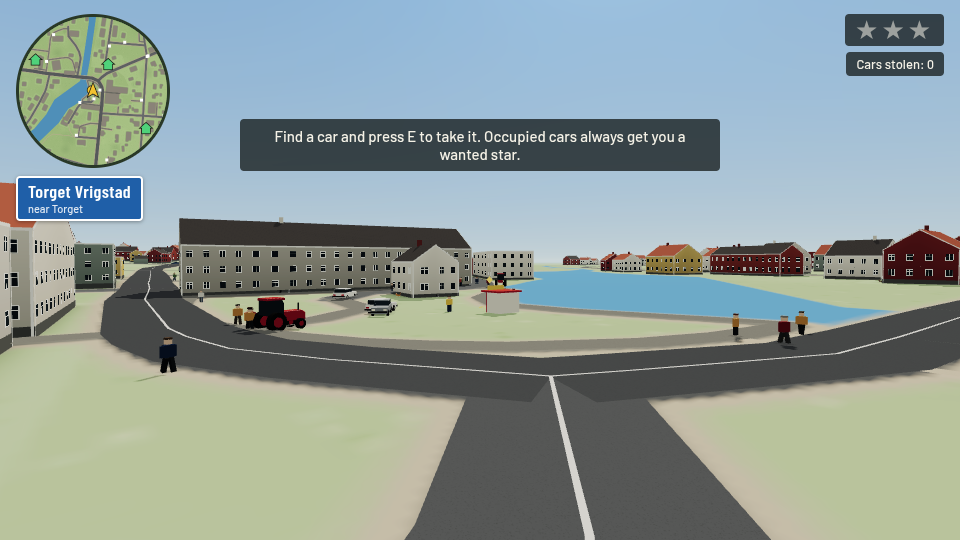
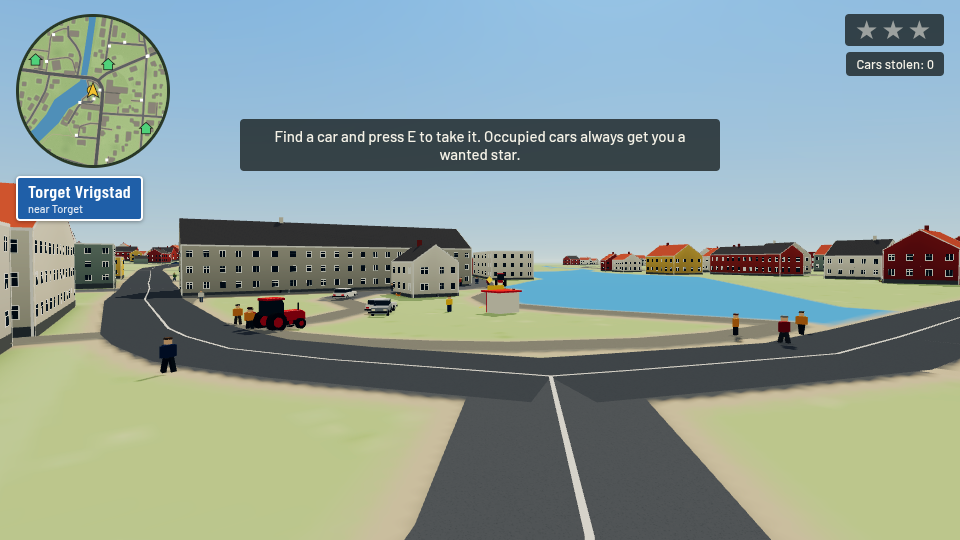
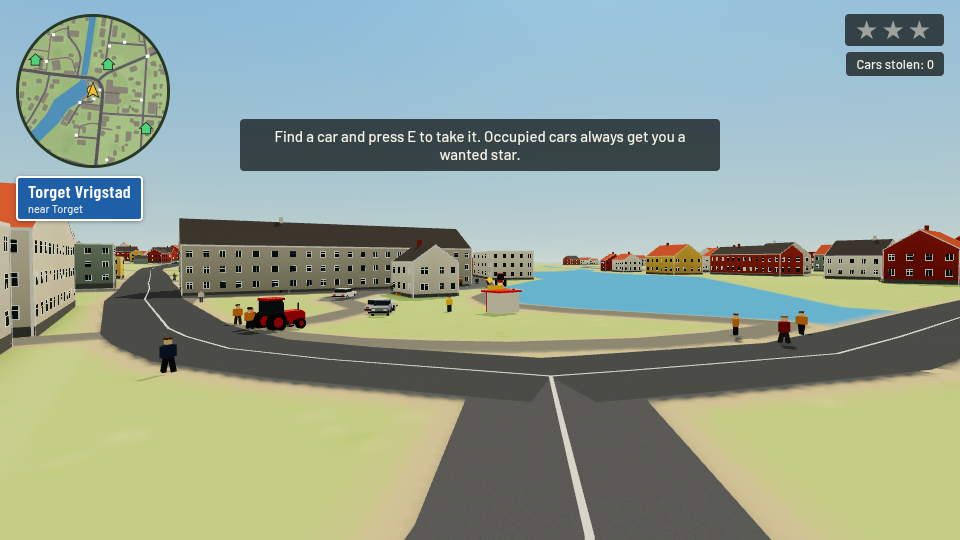
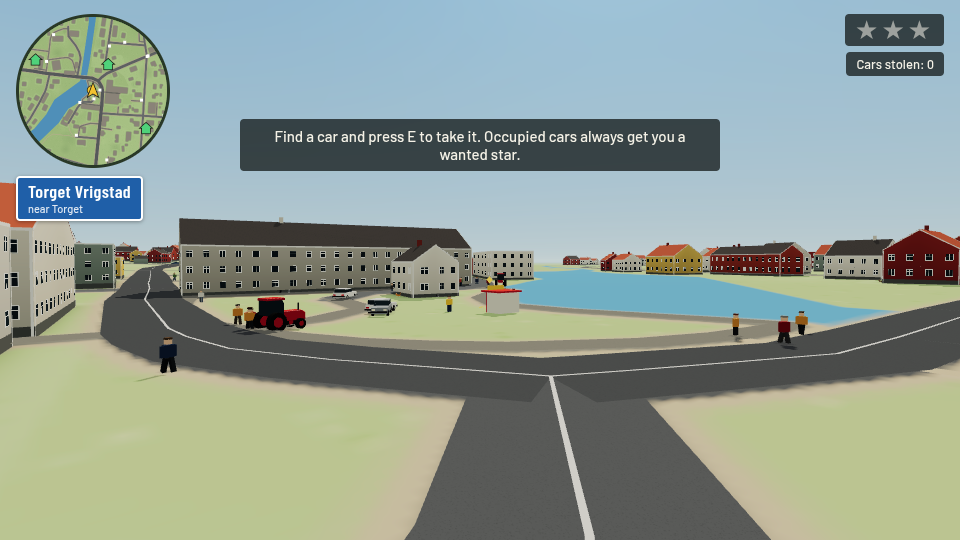
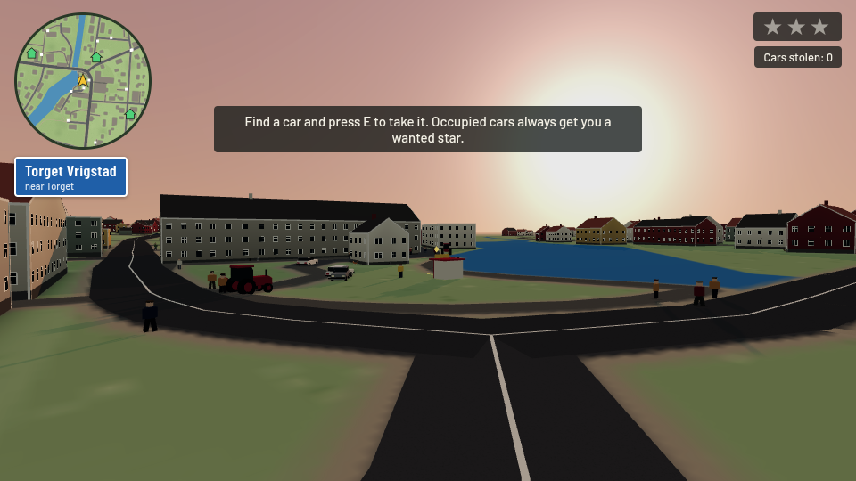
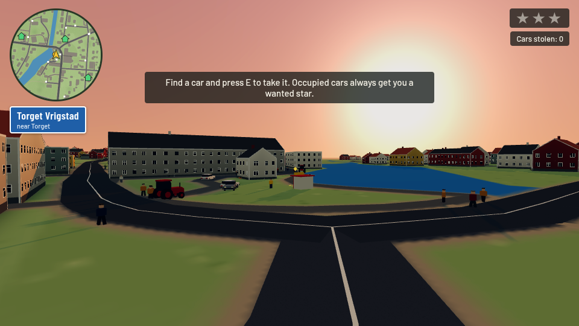
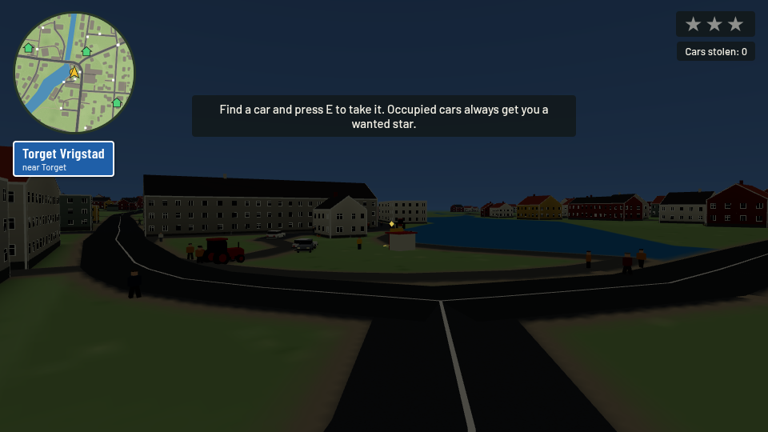
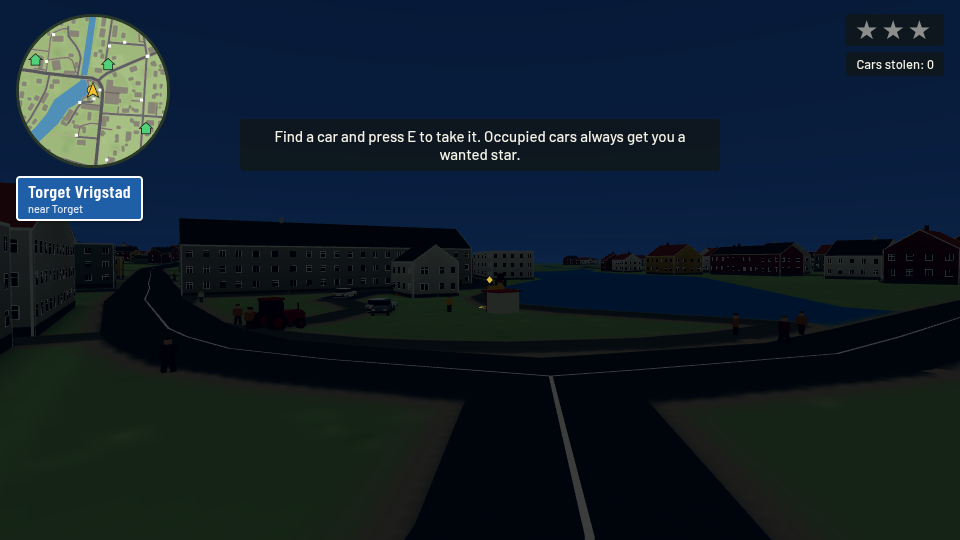
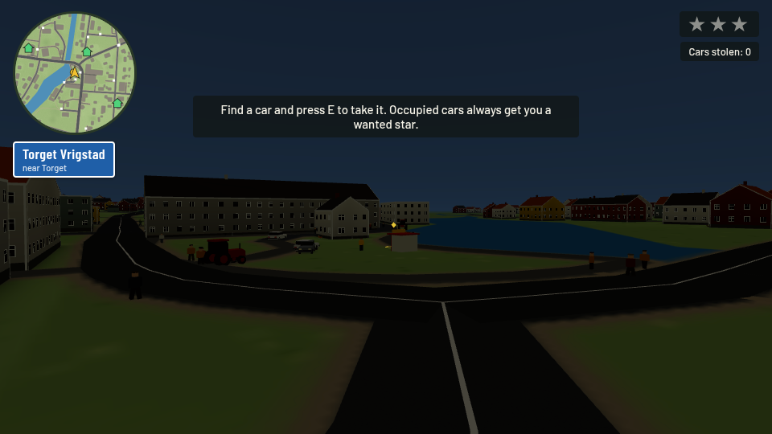

# Optional photographic color profiles — r187 dependency preview

**Blocked by upstream [#143](https://github.com/OliverRomhagen/vrigstad-joyride/pull/143), then [#147](https://github.com/OliverRomhagen/vrigstad-joyride/pull/147). Both were reviewed and remain open/unmerged.** This is deliberately not a patch against current r128 main.

- Exact reviewed #143 head: `167fac9da8a73f368c9488c5d4c3cead481e6f80`.
- Exact reviewed #147 head / parent of this feature: `4a8be71bfe38aadcd5fdc07e6fe2df5aa5702be4`.
- Fork-only base: `review/upstream-pr147-4a8be71` (unchanged copy of that #147 head).
- Fork head: `contrib/photographic-grades-r187`. One focused feature commit above the dependency snapshot.
- Related upstream [#140](https://github.com/OliverRomhagen/vrigstad-joyride/issues/140) remains open; no closure claim.

No upstream PR/branch is modified or merged. Neither repository's main is changed. After #147 lands, refresh against its actual merged source, rebuild normally and repeat visual/CI checks before proposing upstream submission. If #147 changes while pending, this pinned preview does not silently inherit those changes.

## Architecture reviewed

#143 replaces Python string embedding with Vite imports, `src/game/main.ts`, `src/map/main.ts` and committed single-file production builds. #147 imports `three@0.187.0` from npm, keeps `ColorManagement.enabled=false` in the shared `three-legacy.ts`, scales legacy directional/hemisphere intensities by `LEGACY_LIGHT=Math.PI`, changes encoding properties to color spaces, uses PCFShadowMap and fixes instance bounds. Those migration files and decisions are preserved here. This does not include #150's separate managed-color/physical-unit retune.

New modules are strict typed TypeScript, formatted with Biome; the existing monolithic entry retains upstream's `@ts-nocheck`. There is no new runtime or package dependency. No hand-edited generated HTML, data, map, gameplay RNG or simulation change.

## Color path and r187 API adaptation

A direct rename of the old `WebGLMultisampleRenderTarget` / `.encoding` implementation is incorrect. r187 disables the renderer's tone mapping for ordinary render targets and renders them in its working color space. #147 intentionally keeps display-space fog and a custom sky that writes its display colors directly. Moving that scene wholesale into a conventional linear HDR target would change the fog/sky unless those materials were retuned.

This implementation instead renders the scene **once through the original native canvas path**, uses r187's `FramebufferTexture` and `renderer.copyFramebufferToTexture(texture)` to copy its completed pixels on the GPU, then draws one fullscreen finish. The canvas retains its original antialiasing/MSAA, ACES, sRGB conversion, encoded-fog convention and alpha blending. The RGBA8 copy has `NoColorSpace`, preventing hardware sRGB sampling decode; the finish ShaderMaterial has `toneMapped:false` and no encoding/tonemapping shader chunks. Thus those bytes are neither encoded nor tone-mapped a second time. No `outputEncoding`, texture `.encoding`, removed multisample-target class or WebGL1 path is introduced; r187 requires WebGL2.

Enabled cost is one GPU framebuffer copy, one extra RGBA8 texture and one fullscreen draw; no additional scene render, depth attachment or multisample offscreen target. At 960×540 the texture alone holds 2,073,600 bytes. Off bypasses the entire integration and allocates none of those resources. Texture disposal/recreation follows the actual drawing-buffer size on resize. This is not a CPU readback. The copied image is already 8-bit: it cannot recover highlight detail that upstream clipped before this effect.

Grain and grade candidates deliberately remain independent for review. Their `scene-finish.ts` files are identical. If both are selected, reconcile the two entry-point initializations and combine their uniforms/fragment function in **one** finish; do not instantiate or chain two copies. No duplicate post-processing passes are present in either candidate.

## Selected behavior and matched output

Adapted from fork `8d7198c` / reviewed extraction `1ce3123`: Classic Chrome, Classic Negative, Gold-inspired and Portra-inspired display-space profiles, selected with `?film=chrome|negative|gold|portra`. Missing/off/unknown film uses original native rendering with zero extra resources. **Upstream's default is unchanged.** No dependency on grain, daylight, weather, custom sky or mist. Artistic interpretations, not calibrated film-stock emulation.

There are 18 actual r187 game-scene WebGL captures: direct off, identity and four looks for each of day/sunset/night. Day is #147's native lighting. Sunset/night are explicit browser-only light/sky/fog fixtures because #147 has no native clock; they are not a claim of day/night integration. Camera, orientation, world/player, sun strength and exposure match the separate unchanged #147 reference within each condition. Metadata is committed. The screenshot harness changes actual shader uniforms in one fixed scene; original URL state remains `negative`. Off bypasses the finish but retains the initially allocated copy texture in this harness; production default/off/unknown allocate none, checked separately in smoke tests.

The identity capture was visually compared with each unchanged reference. Pale facades and road markings retain their apparent neutral colors and brightness. Gold adds warmth, Chrome reduces saturation, Negative adds contrast/cooler shadows and Portra is gentler. The shoulder reduces the bright sunset halo but cannot recover details already clipped upstream. Night is dark even in the reference; contrast/tints can reduce visibility further. No profile is proposed as a new default. No assertion claims every weather/material or hardware display is validated.

| day — #147 reference | Identity | Chrome | Negative | Gold | Portra |
| --- | --- | --- | --- | --- | --- |
|  |  |  |  |  |  |

| sunset — #147 reference | Identity | Chrome | Negative | Gold | Portra |
| --- | --- | --- | --- | --- | --- |
|  |  |  |  |  |  |

| night — #147 reference | Identity | Chrome | Negative | Gold | Portra |
| --- | --- | --- | --- | --- | --- |
|  |  |  |  |  |  |

Changed production files: `src/game/render/{scene-finish,photographic-grades}.ts`, focused render/resize/read-only-state wiring in `src/game/main.ts`, generated `index.html`. Tests: seven profile-selection/bypass cases plus drawing-buffer resize, alongside the five original smoke tests.

## Reproduce and remaining validation

```sh
npm ci
npm run check
npm run build
npx playwright install chromium
npm run test:e2e
REVIEW_KIND=grades CHROMIUM_PATH=/usr/bin/chromium node tools/review-rendering.mjs
```

Capture tooling makes a disposable Vite build under `work/` with source transforms for fixed steps, camera, uniforms/fixtures and full-integration timer queries. Production hooks remain read-only. No assertion bodies, shaders, materials, shadow settings or ground texture resolution are suppressed during these captures. To repeat the separate unchanged reference, copy the review tool into a clean #147 snapshot and set `REVIEW_KIND=baseline`. The tool accepts `CHROMIUM_PATH`; by default it uses Playwright's installed Chromium. Attached images used system Chromium/SwiftShader at 960×540 with full production shadows/ground.

The local grain contribution run of the shared finish encountered software-render timeouts, including in the disabled/native path; it is not a passing local test result for this branch. This branch has its own normal smoke cases for hosted CI. Standard hosted CI status and exact test counts are recorded in the PR description once available. There is no reduced-render fixture in this contribution. Hardware/phone performance and human aesthetic acceptance remain open.
