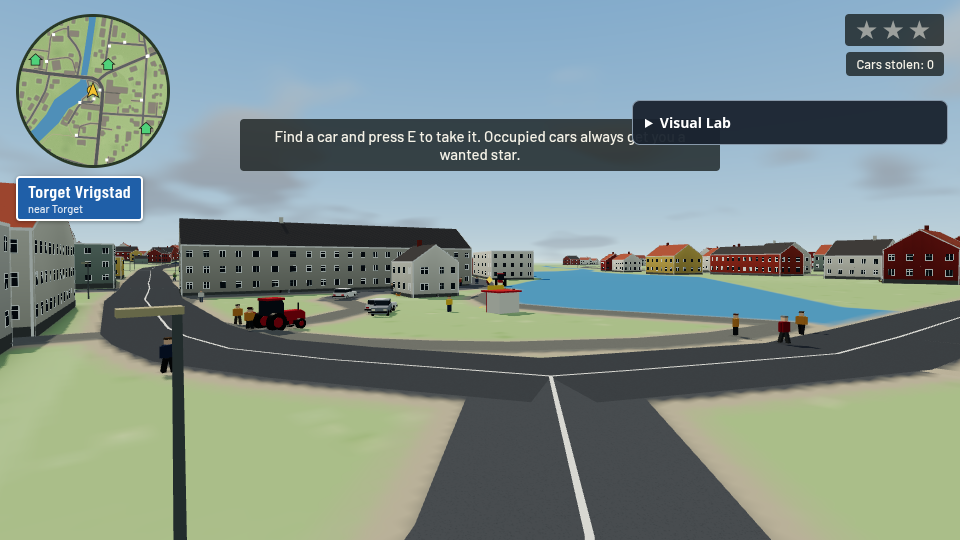
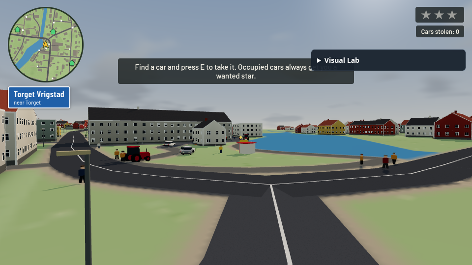
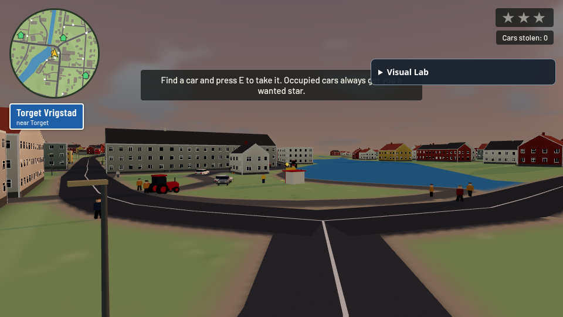
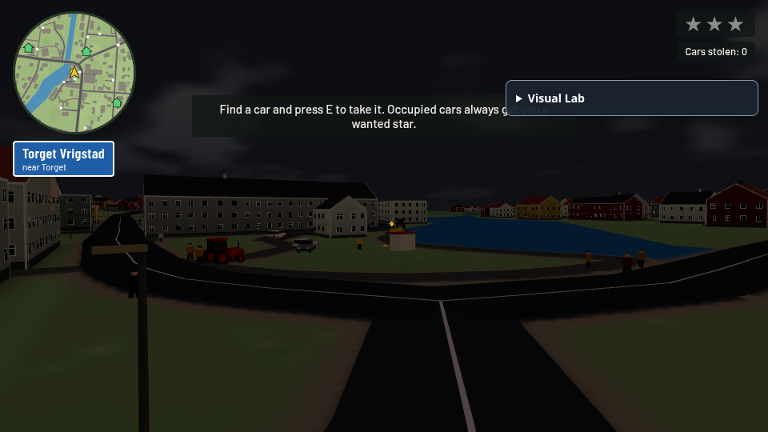
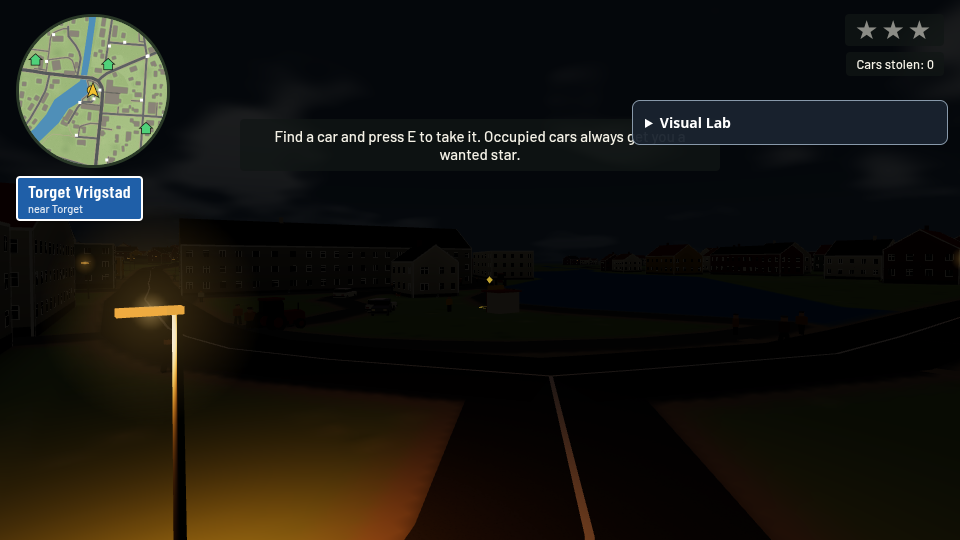
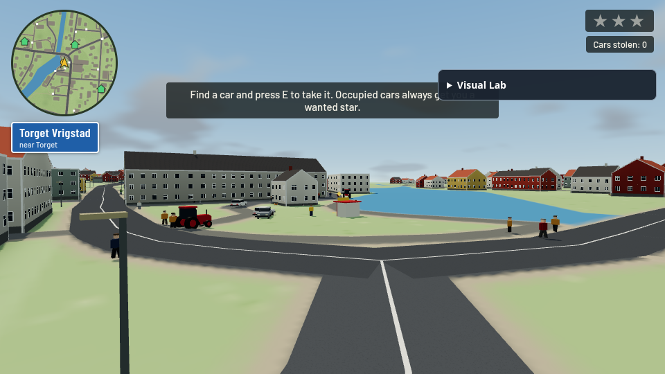
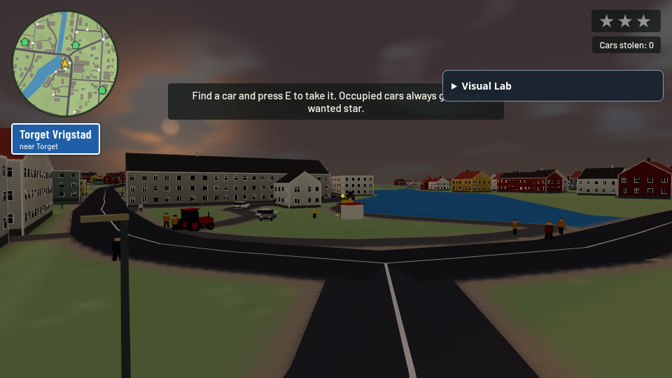
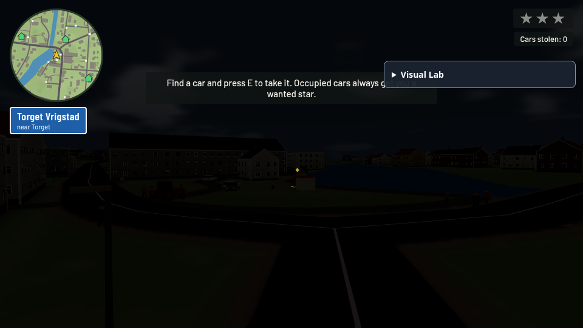
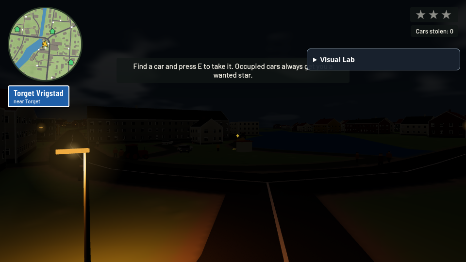

# Geographic daylight and sodium street lights — r187 dependency preview

**Blocked by upstream [#143](https://github.com/OliverRomhagen/vrigstad-joyride/pull/143), then [#147](https://github.com/OliverRomhagen/vrigstad-joyride/pull/147). Both were reviewed and remain open/unmerged.** This is deliberately not a patch against current r128 main.

- Exact reviewed #143 head: `167fac9da8a73f368c9488c5d4c3cead481e6f80`.
- Exact reviewed #147 head / parent of this feature: `4a8be71bfe38aadcd5fdc07e6fe2df5aa5702be4`.
- Fork-only base: `review/upstream-pr147-4a8be71` (unchanged copy of that #147 head).
- Fork head: `contrib/geographic-daylight-r187`. One focused feature commit above the dependency snapshot.
- Related upstream [#99](https://github.com/OliverRomhagen/vrigstad-joyride/issues/99) remains open; no closure claim.

No upstream PR/branch is modified or merged. Neither repository's main is changed. After #147 lands, refresh against its actual merged source, rebuild normally and repeat visual/CI checks before proposing upstream submission. If #147 changes while pending, this pinned preview does not silently inherit those changes.

## Architecture reviewed

#143 replaces Python string embedding with Vite imports, `src/game/main.ts`, `src/map/main.ts` and committed single-file production builds. #147 imports `three@0.187.0` from npm, keeps `ColorManagement.enabled=false` in the shared `three-legacy.ts`, scales legacy directional/hemisphere intensities by `LEGACY_LIGHT=Math.PI`, changes encoding properties to color spaces, uses PCFShadowMap and fixes instance bounds. Those migration files and decisions are preserved here. This does not include #150's separate managed-color/physical-unit retune.

New modules are strict typed TypeScript, formatted with Biome; the existing monolithic entry retains upstream's `@ts-nocheck`. There is no new runtime or package dependency. No hand-edited generated HTML, data, map, gameplay RNG or simulation change.

## Port selection and changes for r187

Selected systems from fork `8d7198c` / reviewed extraction `8edfcd4`: geographic sun at 57.3555° N / 14.4756° E, absolute UTC clock exposing Stockholm civil time/DST, seasonal altitude/day length, smooth multi-day clouds, cloud attenuation, warm twilight/atmospheric sky glow, automatic sodium street lighting and lighting-only Visual Lab. No film/grain/custom post-processing dependency. The adapter updates #147's existing dome, hemisphere, sun, exposure and fog; there is no competing sky or fullscreen pass.

The former Python embed markers are replaced by TypeScript imports. Pure solar/calendar/weather code is separated from the renderer adapter and optional DOM lab. Directional and hemisphere updates use #147's shared `LEGACY_LIGHT` factor. Existing color conversions remain valid because #147 keeps color management off. Point lights use a named **125 candela** setting for r187's inverse-square attenuation instead of blindly retaining r128's 3.8 legacy light intensity. That brightness is an artistic starting value, verified in the attached lamp off/on views rather than presented as an exact numerical light-unit conversion.

The r128 black-specular Phong ground workaround is removed: #147's r187 Lambert already lights per pixel. Terrain/roads retain their original upstream materials. No copy, post-processing target or final pass is added.

## Controls and limits

Default calendar: August 15 2026, 15:30, accelerated continuous day (12 real minutes/day). `?time=13&date=2026-06-21` fixes a civil time/date; `?cycle=on|off`, `?daySpeed=1`, `?lighting=off` control it. `?dev=lighting` opens the optional time/date/cloud/glare/streetlight lab. Disabling lighting restores upstream static lighting; the added roadside pole geometry remains. Panel input blocks driving keys.

Solar elevation controls automatic lamps: fade below the horizon, fully on below −6°. One shared UTC clock handles spring skipped and autumn repeated civil hours, midnight and year rollover; ambiguous autumn input chooses the first occurrence and spring gaps normalize forward. Future seasons [#114](https://github.com/OliverRomhagen/vrigstad-joyride/issues/114) should consume this clock; snow, seasons/holiday events and gameplay schedules are not implemented. Related street furniture #144 only receives lamps, not benches/bins.

There are 302 deterministic, instanced roadside lamps in this map, with four nearby real point lights (two on coarse devices), depth-tested halos and no lamp shadow maps. Placement avoids buildings, water, steep slopes and nearby road corridors without consuming gameplay RNG. Shadowless point lights can still leak through walls. The glare is occludable atmospheric sky glow, not calibrated lens glare. No headlights; distant unlit roads remain dark. Point-light shader work, glow draws, all-season tuning, longer driving/touch sessions and real GPU/mobile performance remain review items.

## Observed verification

`npm run check`, production build, solar/weather/calendar/DST and deterministic street-placement/schedule tests passed. Nine final actual full-shadow WebGL views completed with no reported page/console/shader warnings/errors and GL error zero. The real control-event check blocked driving keys. Summer noon elevation: 56.09°, winter noon: 8.24°; 0 active daylight light slots, 4 at 22:00. The sodium-lit road pools were visually inspected with native r187 Lambert. These selected views are not every season/weather condition or a hardware signoff.

Changed production files: `src/game/render/{solar-clock,daylight,street-lighting,visual-lab}.ts`, focused wiring/existing dome expansion in `src/game/main.ts`, generated `index.html`. The pure check scripts and one new solar-date/Visual Lab smoke test accompany the five original smoke tests.

| time-13 | time-17 | time-19 |
| --- | --- | --- |
|  |  |  |

| time-20.5 | time-22 | 2026-06-21 |
| --- | --- | --- |
|  |  |  |

| 2026-12-21 | street-off | street-on |
| --- | --- | --- |
|  |  |  |

## Reproduce and remaining validation

```sh
npm ci
npm run check
npm run build
npx playwright install chromium
npm run test:e2e
node tools/check_daylight.mjs
node tools/check-lighting-lab.mjs
REVIEW_KIND=daylight CHROMIUM_PATH=/usr/bin/chromium node tools/review-rendering.mjs
```

Capture tooling makes a disposable Vite build under `work/` with source transforms for fixed steps, camera, uniforms/fixtures and full-integration timer queries. Production hooks remain read-only. No assertion bodies, shaders, materials, shadow settings or ground texture resolution are suppressed during these captures. To repeat the separate unchanged reference, copy the review tool into a clean #147 snapshot and set `REVIEW_KIND=baseline`. The tool accepts `CHROMIUM_PATH`; by default it uses Playwright's installed Chromium. Attached images used system Chromium/SwiftShader at 960×540 with full production shadows/ground.

The local grain contribution run of the shared finish encountered software-render timeouts, including in the disabled/native path; it is not a passing local test result for this branch. This branch has its own normal smoke cases for hosted CI. Standard hosted CI status and exact test counts are recorded in the PR description once available. There is no reduced-render fixture in this contribution. Hardware/phone performance and human aesthetic acceptance remain open.
